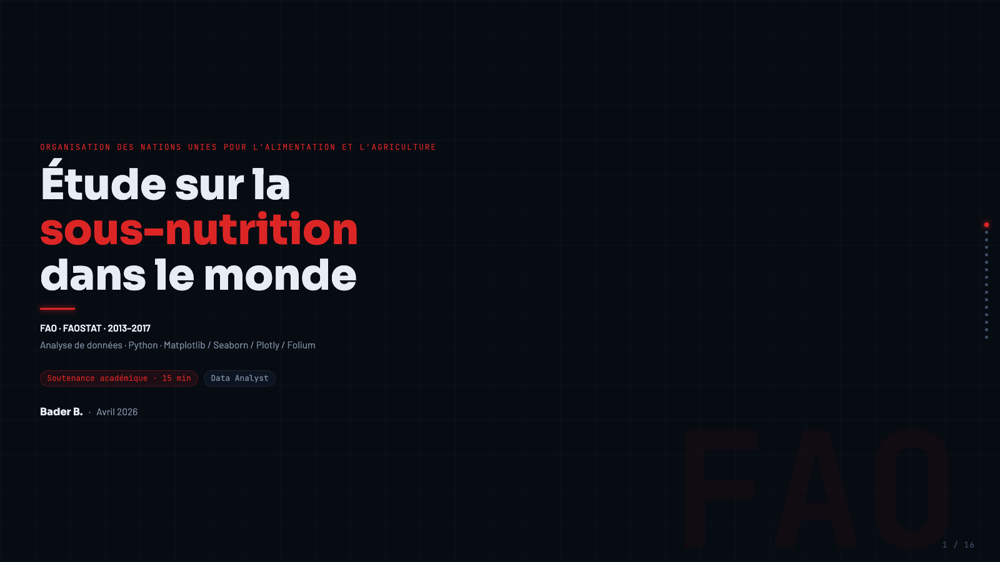
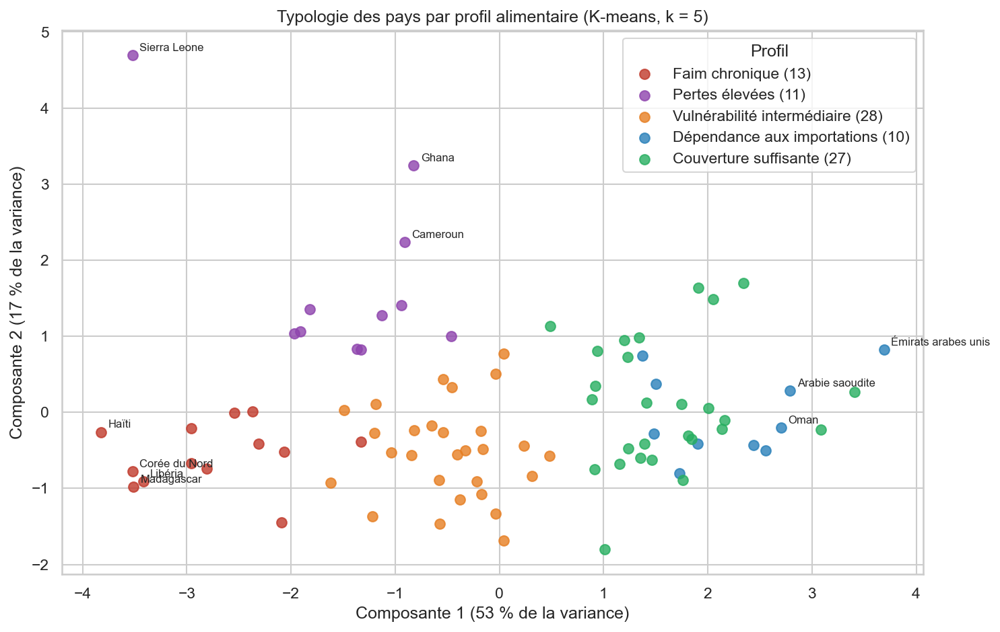
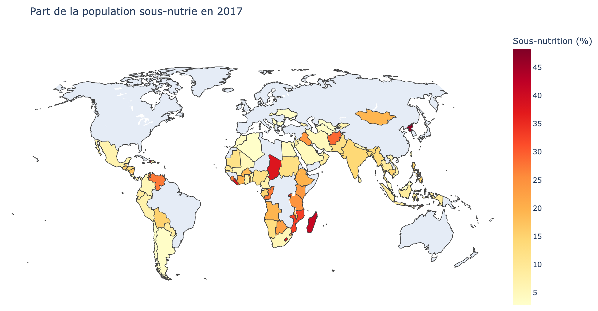

# 🌍 Global Undernutrition: a FAO Data Study (2013 to 2017)

**Does the world produce enough food to feed everyone, and if so, why are 535 million people still undernourished?** A public health study in Python on four FAOSTAT extracts, extended after delivery with a typology of countries by food profile.

[](https://bader28-lab.github.io/global-undernutrition-fao-analysis/)

👉 **[View the presentation](https://bader28-lab.github.io/global-undernutrition-fao-analysis/)** · **[Read the notebook on nbviewer](https://nbviewer.org/github/bader28-lab/global-undernutrition-fao-analysis/blob/main/notebooks/fao_undernutrition_analysis.ipynb)**

Project 4 of the OpenClassrooms Data Analyst program · Deliverables (notebook, presentation) are in French.

## 📋 Business context

A researcher at a food security agency (case study) is preparing a study on undernutrition and asks for figures to support it:

1. The share of the world population that is undernourished.
2. How many people the available food could theoretically feed, in total and with plant products only.
3. How food supply is used: human food, animal feed, losses, processing.
4. The countries most affected, the largest recipients of food aid, and the countries with the lowest and highest calorie supply.

## 🎯 Key results

- **535.7 million people undernourished in 2017**, 7.1% of the world population.
- **Food supply could feed 110.9% of the world population** (8.37 billion people at 2,500 kcal a day), and 91.5% with plant products alone. Undernutrition is a problem of distribution and access, not of production.
- **Less than half of domestic supply feeds people directly** (49.5%). For cereals, 42.8% goes to human food and 36.3% to animal feed.
- **Haiti (48.3%) and North Korea (47.2%)** have the highest share of undernourished people, about 7 times the world average.
- **Thailand exports 83.4% of its cassava** while 9.0% of its population is undernourished.
- **Five country profiles, five different levers** (added after delivery): chronic hunger (13 countries, about a third of the population undernourished), high post harvest losses (11 countries, mostly in West Africa, where 14% of the supply is lost), import dependence (10 countries, 77% of supply imported), intermediate vulnerability and sufficient supply.



## 📁 Data

Four FAOSTAT extracts, aggregated by country:

| File | Content | Period |
|---|---|---|
| `population.csv` | Population by country | 2013 to 2018 |
| `dispo_alimentaire.csv` | Food balance sheet by country and product: production, trade, uses, calories, proteins | 2017 |
| `sous_nutrition.csv` | Number of undernourished people, 3 year averages | 2012-2014 to 2016-2018 |
| `aide_alimentaire.csv` | Food aid received by country, product and year | 2013 to 2016 |

These files were prepared for the course and are not redistributed here. The same indicators are available on [FAOSTAT](https://www.fao.org/faostat/) (Food Balances, Suite of Food Security Indicators, Food Aid Shipments). `data/zone_iso3.csv` is my own table linking FAO country names to ISO codes.

## 🔬 Approach

| Decision | Why |
|---|---|
| All quantities converted to people and kilograms first | The files mix thousands of people, thousands of tonnes and tonnes. One unit avoids silent errors of a factor 1,000 |
| Missing flows in the food balance set to 0 | A missing value means the flow does not exist for that product (no exports, no seeds), not an unknown amount |
| 2016-2018 average used for 2017 | Undernutrition is published as 3 year averages; this one is centered on 2017 |
| `<0.1` estimates left out of the world total | They cannot be quantified precisely; the impact is at most 2 million people (20 countries × 100,000) |
| 2,500 kcal a day as the reference need | A simple average for an adult, used to convert calories into a number of people fed |
| Hand checked country to ISO table for the map | Fuzzy name matching produced wrong codes (see below) |
| Per capita indicators for the typology | With absolute volumes, a clustering mostly groups countries by size |

### After delivery

I reviewed my own notebook after the defense. The commit history shows each step:

- **Clean notebook**: same analysis and same results, without exploratory duplicates. Chart values are now computed from the data instead of being typed in.
- **Map fix**: the delivered map matched French country names to ISO codes with fuzzy search. It drew India's rate on Papua New Guinea and Niger's on Nigeria, among others. Codes now come from a checked table, and the notebook asserts that no code is used twice.
- **New typology**: the delivered clustering used absolute volumes and isolated India in its own cluster, a size effect. The new one uses six per capita or share indicators (undernutrition rate, calories, proteins, animal share, import dependence, losses), standardized, with k chosen by the elbow and silhouette scores, and groups named from their average profile. Countries under one million inhabitants are excluded, because rounding the `<0.1` estimates gave rates up to 70% for very small populations.



## 🎓 Skills

- Clean and harmonize several datasets with different units and granularities
- Join datasets on country and year, and check what each join keeps or drops
- Turn a business question into indicators, and state the assumptions behind them
- Build a K-means typology: feature design, scaling, choice of k, interpretation, PCA projection
- Spot and fix a silent data quality bug in a published visual
- Present findings to a non technical audience

## 🛠️ Tech stack

| Tool | Use |
|---|---|
| Python, pandas | Data preparation and analysis |
| Matplotlib, Seaborn | Charts |
| Plotly, Folium | Static and interactive maps |
| scikit-learn | K-means, scaling, silhouette, PCA |
| Jupyter | Analysis notebook |
| HTML, CSS, JavaScript | Presentation website (GitHub Pages) |

## 🗂️ Repository structure

```
├── notebooks/
│   └── fao_undernutrition_analysis.ipynb   Full analysis (French)
├── data/
│   └── zone_iso3.csv        FAO country names to ISO codes (FAOSTAT files not included)
├── images/                  Charts and maps exported by the notebook
├── docs/                    Presentation website, served by GitHub Pages
└── requirements.txt
```

The notebook is large because of its charts: [open it on nbviewer](https://nbviewer.org/github/bader28-lab/global-undernutrition-fao-analysis/blob/main/notebooks/fao_undernutrition_analysis.ipynb) if GitHub does not display it.

## ▶️ How to reproduce

```bash
python -m venv .venv && source .venv/bin/activate
pip install -r requirements.txt
# place population.csv, dispo_alimentaire.csv, sous_nutrition.csv and aide_alimentaire.csv in data/
cd notebooks && jupyter notebook fao_undernutrition_analysis.ipynb
```

## ⚠️ Limitations

- **Supply, not consumption**: food balance sheets measure what is available in a country, not what households actually eat or waste.
- **2,500 kcal is a simplification**: real needs vary with age, sex and activity, so the "people fed" figures are orders of magnitude.
- **Incomplete aid data**: some countries have no 2016 record. A missing year means no data, not zero aid.
- **Typology scope**: 89 countries with a published undernutrition estimate and at least one million inhabitants. Most high income countries have no estimate and are not covered. Silhouette scores are modest: countries form a continuum, and the groups are a help for prioritizing, not hard boundaries.
- **The presentation predates the review**: it calls 2,500 kcal a minimum survival threshold, which overstates it, and does not include the typology.

## 🔒 Privacy

Country level public statistics only: no personal data at any step.

## 👤 Author

**Bader B.**, Data Analyst in training at OpenClassrooms
